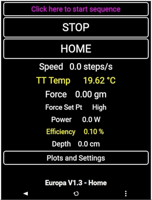
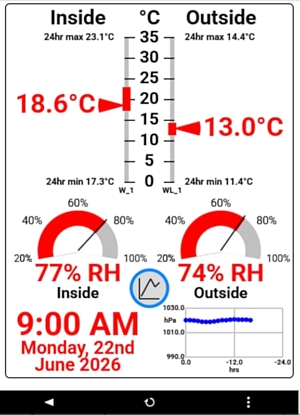
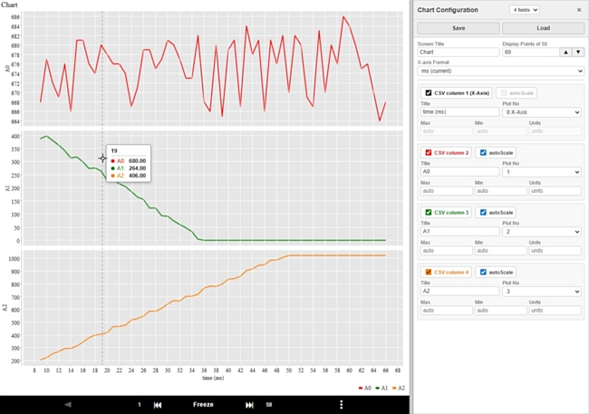

# pfodParser / pfodWeb Client
The **pfodParser** / **pfodParserCPP** / **pfodParserC** libraries serve user interfaces and handles user commands sent from 
[pfodWeb](https://www.forward.com.au/pfod/pfodWeb/index.html)
and the
[Android pfodApp](https://www.forward.com.au/pfod/index.html).  
See the README.md files in their respective sub-directories.

  

## pfodWeb Designer
pfodWeb.html includes a <strong>Designer</strong> that has been optimized for 
use by AI coding assistants. The Designer that lets you create your own menus, sub-menus, 
charts, etc and then generate the complete Arduino for your selected board (over 600 variants) or code for your non-Arduino board to compile and upload. See [pfodDesignerV3 tutorials and examples](https://www.forward.com.au/pfod/pfodDesigner/index.html). 

## This Library Includes:-

**pfodParser** library parses pfod commands and serves the GUI using the Arduino framework  
**pfodParserCPP** a plain CPP library that parses pfod commands and serves the GUI for micros not using the Arduino framework  
**pfodParserC** exampes of code generated by pfodWeb designer that parses pfod commands and serves the GUI for very small micros

<strong>pfodWeb.html</strong> (in the **pfodParser/pfodWeb sub-directory**)  GUI Designer, code generator, and client that connects via Serial,
 BLE, TCP/IP or HTTP to display interactive GUI's. 
 Displays your GUI and runs in your off-line brower. The entire GUI is completely controlled by your micro's sketch.  
  pfodWeb.html can connect to any microprocessor board that has a Serial connection.
It can also connect via BLE, TCP/IP Socket or HTTP. _Serial, BLE and TCP/IP connect via pfodProxy_.  
See [pfodWeb Installation and Tutorials](https://www.forward.com.au/pfod/pfodWeb/index.html). 
 
 See **pfodParser/examples/pfodWeb** for Arduino examples   
See  **pfodParser/pfodParserCPP/examples** for examples for micros that don't use the Arduino framework,
 e.g. STM32, Microchip SAM and PIC32, etc.  
See **pfodParser/pfodParserC/examples** for small micro examples, e.g. ATtiny84 and  PIC16/PIC18.

## Using pfodParsers/pfodWeb with an AI assistant

 In the pfodParser library under ***pfodParser/pfodWeb/docs*** are
 three .md files for the AI assistant to consume.  

**pfodAI-guide.md** -- an guide for the AI assistant on how to turn a user's design request in to a UI.  
**pfodMenu_json-format.md** -- an AI guide on how to create valid json definitions for pfod menus.  
**pfodDwg_json-format.md** -- an AI guide on how to create valid json definitions for pfod drawings.  

Point the AI at those three files and describe the contents of the UI you want to build. Tell the AI to pause after each
interation so you can make your own edits/modification to the UI using pfodWeb's UI preview and editing capabilities.  
While the AI can create the general design, the fine adjustment to make it look just right are often easier done by hand
using the preview/edit features of pfodWeb.  For changes that effect multiple similar items, use the pfodWeb editor to determine the exact
change required and then ask AI to implement it for the all the effected items. 

If you use Claude-in-Chrome or similar, your AI can drive
the entire interation from creating the json files to loading them into pfodWeb's desinger for you to preview.
  Ask claude to save the main dwg at each iteration. This gives you a snapshot of the json files of the design at that stage.
If you make changes yourself, save the main dwg and point the AI at it to pickup your edits.

 

# Quick Start -- Arduino

* Compile and upload the _**examples → pfodParser → pfodWeb → demoScreens_Serial**_ example sketch to your UNO or higher board
* Open .../Arduino/libraries/pfodParser/pfodWeb/pfodWeb.html in your browser and follow the pfodProxy Instructions to install the pfodProxy for your OS
* Select the COM port for your board and Connect to display a demo of various pfod menu items, sub-menus, dwgs and charts.

# How-To
See [pfodWeb Installation and Tutorials](https://www.forward.com.au/pfod/pfodWeb/index.html)  
See [pfodParser Examples](https://www.forward.com.au/pfod/index.html)  
See [pfodDesignerV3 tutorials and examples](https://www.forward.com.au/pfod/pfodDesigner/index.html)  
See [pfodParser Documentation](https://www.forward.com.au/pfod/pfodParserLibraries/index.html)  

# pfodWeb
The pfodWeb sub-directory contains the single web page client, <strong>pfodWeb.html</strong>, that runs in all browsers since 2017.
No local server is required. You can run pfodWeb on a completely isolated network with no internet access.  
pfodWeb can also be served directly from your micro for a completely self-contained deployment. See the **pfodParser/examples/pfodWeb/demoScreens_http** Arduino example.  

For the Designer/Code Generator and HTTP connections, no additional downloads are required. For Serial, BLE and TCP/IP connection
 download the pfodProxy (windows,macOS or linux).  See [pfodWeb_startup.html](https://www.forward.com.au/pfod/pfodWeb/pfodWeb_startup.html).

The **pfodWeb/data** sub-directory contains pfodWeb as .gz files suitable for serving from your microprocessor for a completely self-contained deployment.   
The **pfodWeb/docs** sub-directory contains the docs for pfodWeb.

pfodWeb is open-source. The source is available from [pfodWeb_src.zip](https://www.forward.com.au/pfod/pfodWeb/pfodWeb_src.zip) 
and github hosted at [pfodWeb_src](https://github.com/drmpf/pfodWeb_src) 

## pfodApp
There is also an Android App version of pfodWeb, [pfodApp](https://play.google.com/store/apps/details?id=au.com.forward.pfodApp) supports WiFi, BLE, Bluetooth and SMS connections.   

# Software License
(c)2014-2026 Forward Computing and Control Pty. Ltd.  
NSW Australia, www.forward.com.au  
This code is not warranted to be fit for any purpose. You may only use it at your own risk.  
This code may be freely used for both private and commercial use  
Provide this copyright is maintained. See pfodWeb/docs/pfodWeb_pfodProxy_License.html for the inherited licenses. 

# Revisions 
Version 5.1.13  added pfodParserCPP library, pfodWeb V4.1.19, pfodCircularLineBuffer: pfodReadCursor is now a struct (pos + totalBytesWritten)   
Version 5.1.12 ESP_PicoW_pfodWebServer: fixed raw data (getRawDataWriter()) being lost/split arbitrarily between multiple simultaneously-polling pfodWeb clients  
Version 5.1.11 pfodCircularLineBuffer: added getReadCursor()/setReadCursor() for exact resumable reads across long-lived buffers  
Version 5.1.8 added pfodParserAI-guide.md for pfodDelay usage  
Version 5.1.7 pfodWeb V4.1.9 made indices statble on reboot, added more AI restictions to assisted UI coding, fixed code generation bug when menu had two dwg menu items  
Version 5.1.5 pfodWeb V4.1.7 breaking change, clear browser storage and reload all dwgs  
Version 5.1.4 pfodWeb V4.1.6
Version 5.1.2 pfodWeb V4.1.3  
Version 5.1.1 pfodWeb V4.1.2, and bug fix in pfodCircularLineBuffer  
Version 5.1.0 pfodWeb V4.1.0  
Version 5.0.3 Added mouser over data display to charts  
Version 5.0.2 Revised pfodProxy connection  
Version 5.0.1 Complete pfodWeb V4.0.0 and bug fixed located by claude  
Version 5.0.0 Almost complete pfodWeb  
Version 4.1.2 Updated data sub-dir  
Version 4.1.1 Added images to documentation  
Version 4.1.0 Revised HTTP connection support for pfodWeb, ESP_Pico_pfodWebServer  
Version 4.0.0 Added Charting support to pfodWeb  
Version 3.66.6 Updated pfodWeb examples  
Version 3.66.5 Added cache control setting for pfodWeb http. Updated data subdir. Now needs 1M FS space   
Version 3.66.4 Fixed pfodWeb value display and added basic charting to pfodWeb
Version 3.66.3 Fixed scaling of nested drawings.  
Version 3.66.2 Fixed display of nested drawings.      
Version 3.66.1 Added support for pfodWeb to connect Serial and BLE connection.    
Version 3.65.1 revised pfodWeb examples and serving of pfodWeb files. Added support for Serial and BLE connection  
Version 3.64.1 Breaking Change. pfodDrawing sub-classes now need to call init() to complete initialization and to add them to the pfodParser linked list. Added source files .html / .js for pfodWeb  
Version 3.64.0 added pfodWeb support for Pi PicoW/2W, ESP32 and ESP8266, added pfodDebugPtr, pfodESPBufferedClient now supports Pi Pico W/2W  
Version 3.63.11 pfodESPBufferedClient now also supports Pi Pico W / 2W  
Version 3.63.10 added clear() method to pfodStreamString for Pi PicoW  
Version 3.63.9 added JSON escaping of control chars in the range 0x00 to 0x1F  
Version 3.63.8 fix newline fitering in pfodStreamString add JSON escapes  
Version 3.63.7 added newline fitering to pfodStreamString  
Version 3.63.6 added DOWN_DRAG_UP alias for DOWN_UP  
Version 3.63.5 added pfodStreamString  
Version 3.63.4 corrected empty cmd test  
Version 3.63.3 added specification to docs (mainly for AI reference)  
Version 3.63.2 added parse timeout  
Version 3.63.1 added multiple connections support  
Version 3.62 added default initializations  
Version 3.61 added linked list for processing dwg cmds, added pfodESPBufferedClient, fixed label/touchActionInput encoding  
Version 3.60 revised arguments to support pfodSecurity  
For earlier revisions see the [pfodParser LibraryVersion.txt file](https://www.forward.com.au/pfod/pfodParserLibraries/LibraryVersion.txt)  
