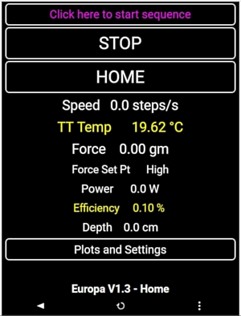
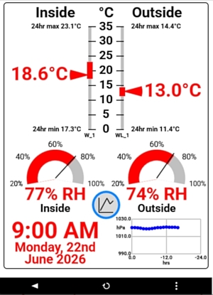
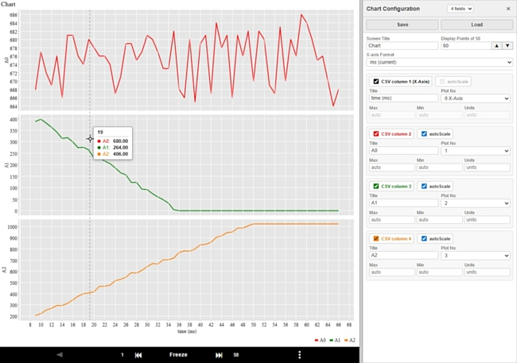

# pfodParserCPP
The pfodParserCPP library serves user interfaces and handles user commands sent from 
[pfodWeb](https://www.forward.com.au/pfod/pfodWeb/index.html)
and the
[Android pfodApp](https://www.forward.com.au/pfod/index.html).  

  

> **Non-Arduino / plain C++:** The `src/` directory is a plain C++ port of the pfodParser
> core parsing and drawing-command library — no Arduino framework dependency, builds
> standalone with CMake. See [Building (non-Arduino)](#building-non-arduino) below and
> [BUILDING.md](BUILDING.md) for full details. 
> See **pfodParserCPP/examples/** for STM32, ESP32 / ESP8266 (SDK), nRF52 (nRF5 SDK), nRF54L (nRF Connect SDK Bare Metal), Raspberry Pi RP2040 / RP2350 (Pico SDK), Microchip SAM and PIC32 (MPLAB Harmony 3), NXP Kinetis and MCX (MCUXpresso SDK) and Zephyr examples
 

pfodWeb.html <strong>Designer</strong> lets you create your own menus, sub-menus, 
charts, etc and then generate the code. See [pfodDesignerV3 tutorials and examples](https://www.forward.com.au/pfod/pfodDesigner/index.html).  
Choose the <strong>pfodParserCPP</strong> target for non-Arduino boards.  
For the pfodParserCPP target the Designer generates the menus and drawings, `main.cpp` and templates for your board's
serial port and clock, but not the board specific parts, as it does not know your micro or SDK. You need to supply:-  
* **The serial port**, complete `begin()`, `write()`, `flush()` and `read()` in the generated `target_Stream.cpp` using your SDK's UART driver, and the `begin()` arguments in `main.cpp`. See the generated `readme.txt`.
* **The clock**, check the `micros()` in the generated `target_pfodClock.cpp` works on your micro. Its default `std::chrono` version often does not on bare metal toolchains, so replace it using your board's timer. Add `yield()` if your board needs it.
* **The startup code**, any clock, pin and SDK initialization your micro needs, and any different entry point, in `main.cpp`. The generated `main()` just calls `setup()` then `loop()` forever.
* **The hardware actions**, what your menu items and drawing buttons actually do, e.g. driving an output pin, by subclassing the generated classes.
* **The project**, your SDK's project or build files, with pfodParserCPP's `src/` and `src/dwgs/` added, and your compiler, to compile and upload.

The **examples/** directory has examples for the following micros, each with a `build.sh`:-  
* **esp32**, ESP32 (ESP-IDF)
* **esp8266**, ESP8266 (ESP8266_RTOS_SDK)
* **stm32**, STM32 (STM32Cube HAL), built for the STM32F401RE
* **nrf52**, Nordic nRF52 (nRF5 SDK), built for the nRF52832
* **nrf54l_bm**, Nordic nRF54L Series (nRF Connect SDK Bare Metal), built for the nRF54L15
* **zephyr**, any Zephyr RTOS board, built for the nRF52840
* **rp2040**, Raspberry Pi RP2040 / RP2350 (Pico SDK)
* **sam**, Microchip SAM (MPLAB Harmony 3), built for the ATSAMD21J18A
* **pic32**, Microchip PIC32 (MPLAB Harmony 3)
* **kinetis**, NXP Kinetis K (MCUXpresso SDK 2.x), built for the MK64FN1M0VLL12 (FRDM-K64F)
* **mcx**, NXP MCX N (MCUXpresso SDK), built for the MCXN947 (FRDM-MCXN947)

The [pfodApp Android client](https://play.google.com/store/apps/details?id=au.com.forward.pfodApp) supports WiFi, BLE, Bluetooth and SMS connections.   
 

# Quick Start

* Choose one of the examples and compile and upload it to your micro
* Open pfodWeb.html, from the pfodWeb sub-directory, in your browser and, if your browser does not support Serial connections natively, follow the pfodProxy Instructions to install the pfodProxy for your OS
* Select the COM port for your board and Connect to display the example user interface.

# Building (non-Arduino)

`src/` (pfodParser, pfodRawCmdParser, pfodDwgs, and supporting buffer/utility
classes) has no Arduino dependency and builds standalone with CMake:

```sh
cmake -S . -B build
cmake --build build
```

This produces a static library `pfodParser` that consumers can link against
(`add_subdirectory(...)` + `target_link_libraries(your_target PRIVATE pfodParser)`
from another CMake project). `src/` is exposed as the public include directory.

* **C++ standard:**  C++11 or later (also compiles cleanly under C++14/17/20).
* **Compilers tested / expected to work:** GCC >= 4.8, Clang >= 3.3. The toolchain must
  support weak symbols (GCC/Clang producing ELF objects, as micro toolchains do), used for
  the default `millis()` and `yield()`, and for the `get_pfodMainMenu()` / `get_dwg_xxx()`
  functions in the pfodWeb generated code. See
  [Common non-Arduino micros and their compilers](BUILDING.md#common-non-arduino-micros-and-their-compilers)
  for a list of micros, their compilers and their weak symbol support.
* **Also needs:** a C99/C11 C compiler (for `HexConversionUtils.c`) and CMake >= 3.10.
* **Clock:** `micros()` is the library's only clock source; `millis()` is derived from it.
  There is no `delay()`. `micros()` is **not** implemented in the library -- your program
  must supply it, e.g. in a `target_pfodClock.cpp`. A `std::chrono::steady_clock` version
  works on ESP-IDF, Zephyr (POSIX), Linux, but not on many bare metal toolchains, where you
  use the board's timer instead. It must wrap from its maximum `unsigned long` value back to 0.
* **yield():** called only by `pfodBufferedStream`, while `write()` (in blocking mode)
  waits for transmit buffer space and while `flush()` waits for the buffer to empty.
  The default in `src/pfodClock.cpp` is weak and empty.
  `yield()` is not defined by ESP-IDF/FreeRTOS/Zephyr. On an RTOS define your own, e.g.
  `void yield() { vTaskDelay(1); }` (FreeRTOS) or `void yield() { k_msleep(1); }` (Zephyr),
  in any `.cpp` of your program to replace it -- do not edit `pfodClock.cpp`.
  See [BUILDING.md](BUILDING.md#clock-micros-millis-and-yield) for both.
* **ESP8266:** only ESP8266_RTOS_SDK is supported. The ESP8266 NonOS SDK is **not**
  supported (its WiFi stack cannot run while pfodBufferedStream waits).

See [BUILDING.md](BUILDING.md) for the manual (non-CMake) build command and more detail.


# pfodWeb
The pfodParser/pfodWeb directory contains the single web page client, <strong>pfodWeb.html</strong>, that runs in all browsers since 2017.
No local server is required. You can run pfodWeb on a completely isolated network with no internet access.  
pfodWeb can also be served directly from your micro for a completely self-contained deployment. See the **pfodParser/examples/pfodWeb/demoScreens_http** Arduino example.  

For client connections via HTTP and for the Designer/Code Generator, no additional downloads are required. For Serial, BLE and TCP/IP connection
 download the pfodProxy (windows,macOS or linux).  See [pfodWeb_startup.html](https://www.forward.com.au/pfod/pfodWeb/pfodWeb_startup.html).

The **pfodParser/pfodWeb/data** sub-directory contains pfodWeb as .gz files suitable for serving from your microprocessor for a completely self-contained deployment.   
The **pfodParser/pfodWeb/docs** sub-directory contains the docs for pfodWeb.

pfodWeb is open-source. The source is available from [pfodWeb_src.zip](https://www.forward.com.au/pfod/pfodWeb/pfodWeb_src.zip) 
and github hosted at [https://github.com/drmpf/pfodWeb_src](https://github.com/drmpf/pfodWeb_src) 


# How-To
See [pfodWeb Installation and Tutorials](https://www.forward.com.au/pfod/pfodWeb/index.html)  
See [pfodParser Examples](https://www.forward.com.au/pfod/index.html)  
See [pfodDesignerV3 tutorials and examples](https://www.forward.com.au/pfod/pfodDesigner/index.html)  
See [pfodParser Documentation](https://www.forward.com.au/pfod/pfodParserLibraries/index.html) and the **pfodParser/pfodWeb/docs/pfodParserAI-guide.md** 
 §6.8 for the differences in pfodParserCPP (`pfodStream`/`pfodPrint` instead of
Arduino's `Stream`/`Print`).  

# Software License
(c)2014-2026 Forward Computing and Control Pty. Ltd.  
NSW Australia, www.forward.com.au  
This code is not warranted to be fit for any purpose. You may only use it at your own risk.  
This code may be freely used for both private and commercial use  
Provided this copyright is maintained. See pfodWeb/docs/pfodWeb_pfodProxy_License.html for the inherited licenses. 

# Revisions 
Version 5.1.0 pfodWeb V4.1.0  
Version 5.0.3 Added mouser over data display to charts  
Version 5.0.2 Revised pfodProxy connection  
Version 5.0.1 Complete pfodWeb V4.0.0 and bug fixed located by claude  
Version 5.0.0 Almost complete pfodWeb  
Version 4.1.2 Updated data sub-dir  
Version 4.1.1 Added images to documentation  
Version 4.1.0 Revised HTTP connection support for pfodWeb, ESP_Pico_pfodWebServer  
Version 4.0.0 Added Charting support to pfodWeb  
Version 3.66.6 Updated pfodWeb examples  
Version 3.66.5 Added cache control setting for pfodWeb http. Updated data subdir. Now needs 1M FS space   
Version 3.66.4 Fixed pfodWeb value display and added basic charting to pfodWeb
Version 3.66.3 Fixed scaling of nested drawings.  
Version 3.66.2 Fixed display of nested drawings.      
Version 3.66.1 Added support for pfodWeb to connect Serial and BLE connection.    
Version 3.65.1 revised pfodWeb examples and serving of pfodWeb files. Added support for Serial and BLE connection  
Version 3.64.1 Breaking Change. pfodDrawing sub-classes now need to call init() to complete initialization and to add them to the pfodParser linked list. Added source files .html / .js for pfodWeb  
Version 3.64.0 added pfodWeb support for Pi PicoW/2W, ESP32 and ESP8266, added pfodDebugPtr, pfodESPBufferedClient now supports Pi Pico W/2W  
Version 3.63.11 pfodESPBufferedClient now also supports Pi Pico W / 2W  
Version 3.63.10 added clear() method to pfodStreamString for Pi PicoW  
Version 3.63.9 added JSON escaping of control chars in the range 0x00 to 0x1F  
Version 3.63.8 fix newline fitering in pfodStreamString add JSON escapes  
Version 3.63.7 added newline fitering to pfodStreamString  
Version 3.63.6 added DOWN_DRAG_UP alias for DOWN_UP  
Version 3.63.5 added pfodStreamString  
Version 3.63.4 corrected empty cmd test  
Version 3.63.3 added specification to docs (mainly for AI reference)  
Version 3.63.2 added parse timeout  
Version 3.63.1 added multiple connections support  
Version 3.62 added default initializations  
Version 3.61 added linked list for processing dwg cmds, added pfodESPBufferedClient, fixed label/touchActionInput encoding  
Version 3.60 revised arguments to support pfodSecurity  
For earlier revisions see the [pfodParser LibraryVersion.txt file](https://www.forward.com.au/pfod/pfodParserLibraries/LibraryVersion.txt)  
